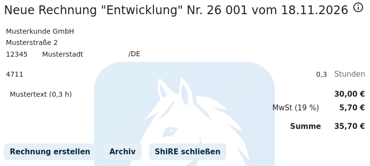
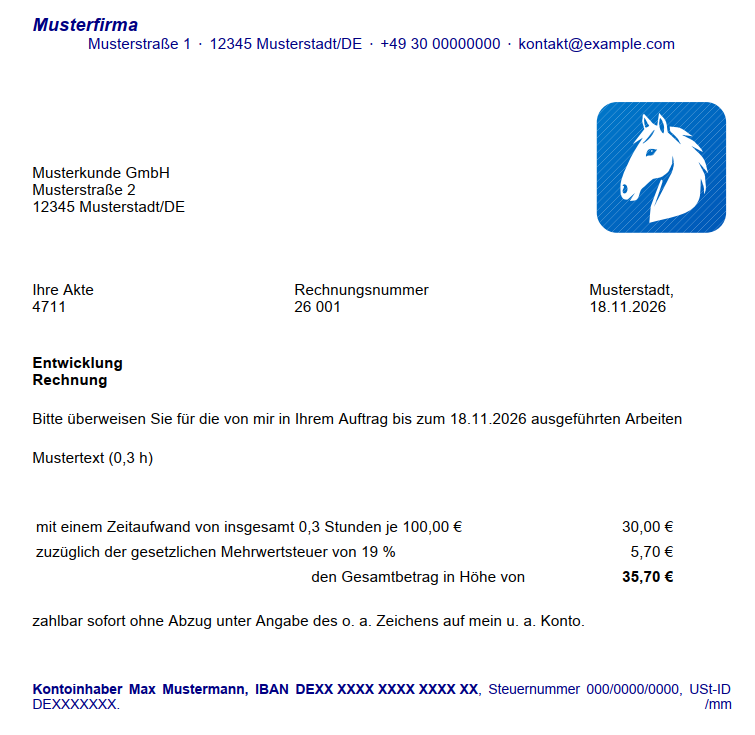

# ShiRE

Nextcloud-App zum Erstellen einer [ZUGFeRD](https://www.ferd-net.de/)-Rechnung auf Grundlage von Vorlagen und Eingaben in einer Eingabemaske.

## Funktionsweise

- Die Rechnungsparameter werden aus einer XML-Vorlage gelesen und in der Eingabemaske ergänzt.
- Optional wird die XML-Datei über [INValidator](https://github.com/322ud/inv_validator) mit dem [KoSIT-Validator](https://github.com/itplr-kosit/validator) geprüft.
- Optional wird die ODT-Vorlage mit denselben Rechnungsparametern ergänzt, mit [LibreOffice](https://de.libreoffice.org/) in eine PDF-Datei exportiert und die XML-Datei mit [MustangCLI](https://www.mustangproject.org/kommandozeile) in die PDF-Datei eingebettet.
- Optional wird das Ergebnis mit [veraPDF](https://verapdf.org) auf den PDF-Standard [PDF/A-3b](https://de.wikipedia.org/wiki/PDF/A) geprüft.
- Die XML-Datei und optional die PDF-Datei werden als Rechnung bereitgestellt.

*Lokale Vorschau der Eingabemaske mit fiktiven Beispieldaten, ohne Nextcloud-Rahmen. Das Erscheinungsbild kann je nach Nextcloud-Design abweichen.*

*PDF-Rechnung aus der ODT-Vorlage mit eingebetteter Rechnungs-XML.*

## Aktueller Stand und Ausblick

Der aktuelle Stand ist eine Machbarkeitsstudie für Rechnungen eines einzelnen Rechnungsstellers mit einer einzelnen Rechnungsposition und festem Nummernformat sowie für die vollständige Stornierung solcher Rechnungen. Rechnungssteller, Vorlagen und Archiv werden appweit gemeinsam verwendet; getrennte Benutzerbereiche sind nicht vorgesehen.

Zukünftige Weiterentwicklungen sind angedacht, aber bisher nicht konkret geplant:

- getrennte Bereiche für mehrere Benutzer,
- Unterstützung mehrerer Rechnungssteller,
- Unterstützung mehrerer Rechnungspositionen.

## Dokumentation

Die [Benutzeranleitung](./docs/user.md) beschreibt das Erstellen einer Rechnung, das Rechnungsarchiv und Storno-Rechnungen.

Die [Administrationsanleitung](./docs/admin.md) beschreibt Installation, Systemvoraussetzungen, Einstellungen und die Nutzung eigener Vorlagen.

Die [Entwicklerdokumentation](./docs/developer.md) beschreibt technische Abläufe, Tests, Frontend-Build und Release-Signierung.

## Zum Namen

[Shire Horses](https://de.wikipedia.org/wiki/Shire_Horse) sind Kaltblüter – der Inbegriff des Zugpferds. Der Name ShiRE spielt damit auf das Rechnungsformat „ZUGFeRD“ an.

## Lizenz

ShiRE: [AGPL-3.0-or-later](LICENSE). Fremdkomponenten: [Hinweise](THIRD_PARTY_NOTICES.md) und [Lizenztexte](LICENSES/).
